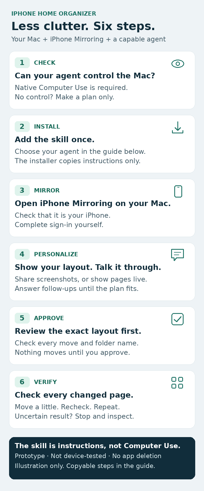

# Quick start: six steps



[Open the full-size image](quick-start.png) · [SVG version](quick-start.svg)

## 1. Check your agent

It must already be able to **see and control your Mac's native iPhone Mirroring window**, including dragging. This skill does not add Computer Use.

**No native control? You can still make a plan, but not apply it automatically.** [Agent compatibility](../README.md#compatibility-instructions-are-not-device-control).

## 2. Install once

Review [the installer](../install.sh) first. In your Mac's Terminal, choose **one** option:

**Codex / Cursor / Gemini CLI / OpenCode:**

```sh
git clone https://github.com/IamShaharFar/iphone-home-organizer.git && sh iphone-home-organizer/install.sh
```

**Claude Code:**

```sh
git clone https://github.com/IamShaharFar/iphone-home-organizer.git && sh iphone-home-organizer/install.sh --agent claude
```

Already cloned the repository? Run `sh install.sh` or `sh install.sh --agent claude` from its folder instead. An existing installed skill is not overwritten: review and move the old copy yourself before reinstalling. [Other install targets and paths](../README.md#quick-install).

## 3. Open iPhone Mirroring

On your Mac, open Apple's **iPhone Mirroring** and confirm the correct iPhone appears. Complete sign-in yourself. Never share passwords or passcodes with the agent.

Need setup help? [Apple's requirements and availability](https://support.apple.com/en-us/120421). Mirroring needs a compatible Mac and iPhone; a browser-only agent is not enough.

## 4. Start the skill and personalize

Select **iphone-home-organizer** in your agent, or ask it to read [SKILL.md](../skills/iphone-home-organizer/SKILL.md).

- Codex: `$iphone-home-organizer`
- Claude Code / Cursor: `/iphone-home-organizer`
- Other hosts: use their documented skill selection, or read the file directly if supported.

**For a better plan:** share privacy-reviewed screenshots of **all Home Screen pages**, plus relevant folder pages and widgets. Hide notifications and sensitive information first. If the agent can inspect those pages live, you do not need to attach the same views again.

Expect a conversation, not one fixed questionnaire. The agent should ask short follow-up questions until it understands your priorities, what must stay, folder preferences, and important tradeoffs. It should not guess answers that would materially change the plan. Ask it to summarize your priorities back before proposing the exact layout. No screenshots or live view? Start with an app list and mark gaps as unknown.

Then send:

```text
Use iphone-home-organizer to organize my iPhone Home Screen.
Check native Computer Use first. Inspect my pages live or use my screenshots.
Ask follow-up questions until you understand my priorities and preferences.
Do not guess important missing details. Keep my Dock and widgets unchanged. Show the exact plan and wait for my
approval. If you cannot control this Mac, give me a manual plan only.
```

## 5. Approve the exact plan

Tell the agent what matters most. Review the proposed app moves and folder names. **Only approve when the exact changes look right.** The agent should not move anything before that approval.

## 6. Check the result

The agent should move items in small batches, recheck each move, then verify every changed page and folder. Review what is **completed, not completed, or not verified**.

If something is uncertain, **stop and check**, rather than repeating blind drags.

---

**Know the limits:** The package is a prototype and has not been end-to-end tested on a device or with the listed agents. Installation copies instructions only. No app deletion or device-setting changes. Screenshots are visual records, not restorable backups; full undo is not guaranteed. Keep personal screenshots and app inventories out of public issues.

The graphic is a workflow illustration, not a device screenshot. [Full instructions and safety details](../README.md).
